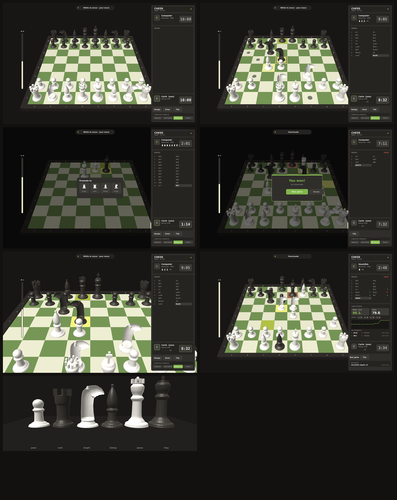
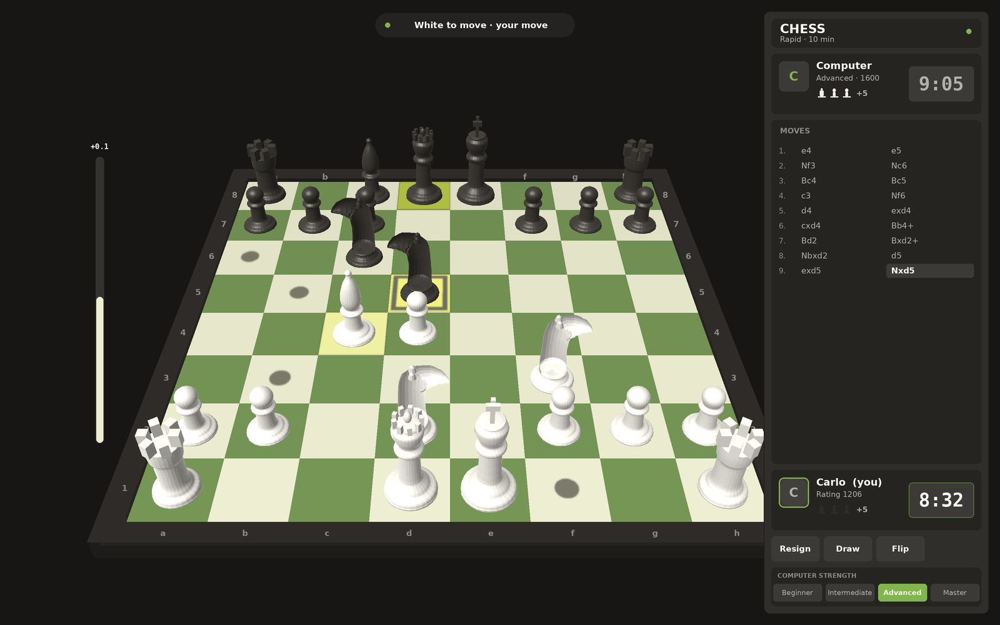
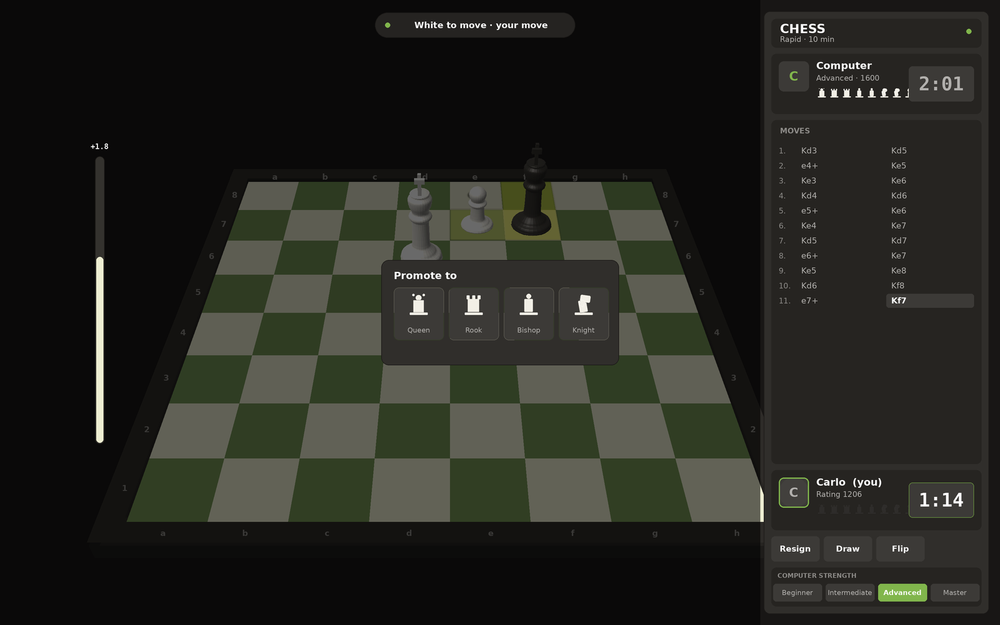
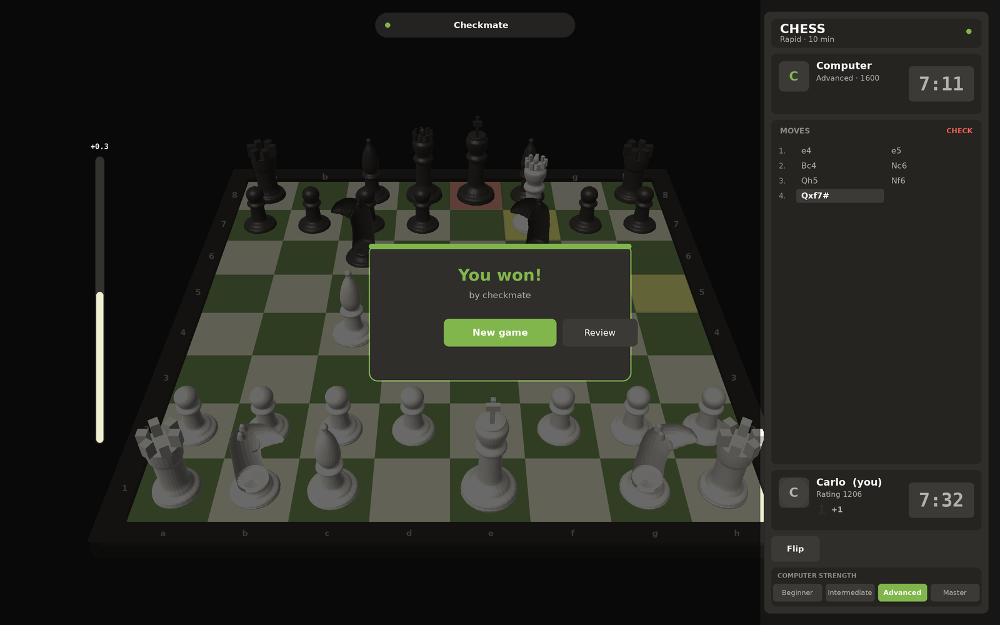
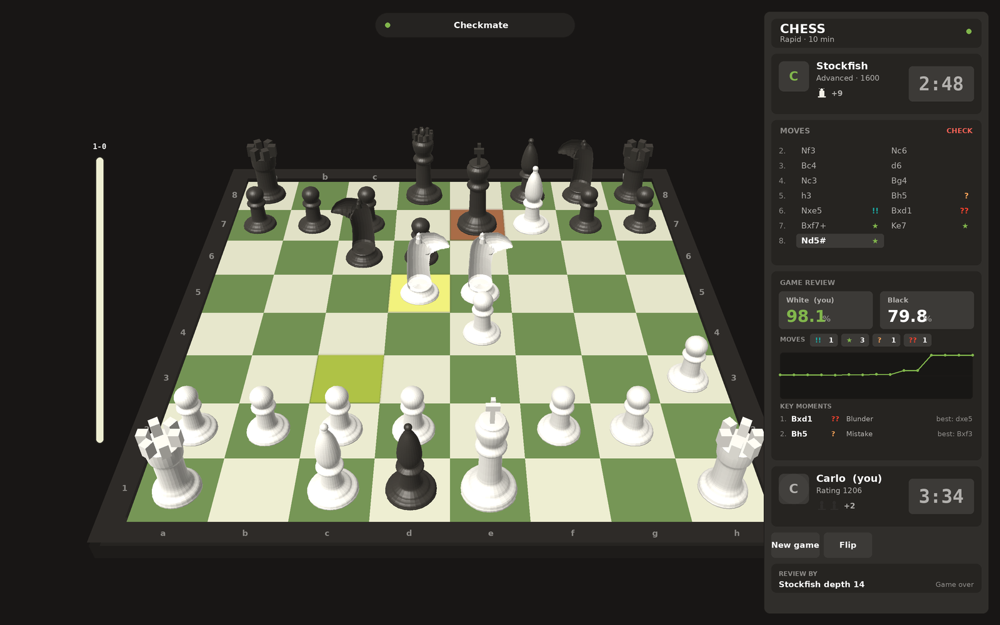
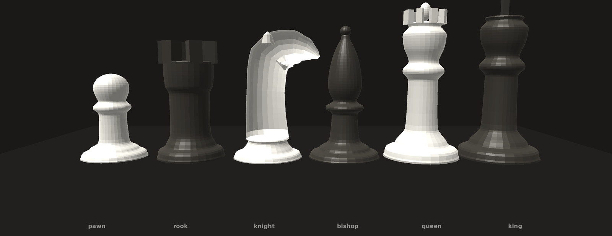

# Roblox Chess — prototype

A chess.com-style chess game for Roblox. Server-authoritative rules engine, a 3D board
you click on, **turned Staunton piece meshes**, live clocks, captured pieces, SAN move
list, promotion picker, draw offers, resignation, a **Stockfish opponent with four
strength levels**, and a **post-game review** that annotates every move chess.com-style
(`!!` `!` `★` `?!` `?` `??`) with accuracy percentages and an eval graph.

**Status: playable prototype (v0.2.0).** Rules are complete and tested, the engine is a
real Stockfish reached over HTTP, the pieces are real geometry, and the review pipeline
runs end to end. Matchmaking, ratings and cosmetics are still minimal — see
[docs/ROADMAP.md](docs/ROADMAP.md).



| Opening | Middlegame (selection + capture ring) |
| --- | --- |
|  |  |
| **Promotion picker** | **Checkmate** |
|  |  |

| Post-game review (real Stockfish evals) | The six pieces |
| --- | --- |
|  |  |

---

## What actually works

**Rules (complete, perft-verified)**
- All legal moves including castling (with through-check rules), en passant, all four promotions
- Check / checkmate / stalemate, threefold repetition, fifty-move rule, insufficient material
- SAN generation with correct disambiguation, `+`/`#` suffixes, and PGN export

**Game shell**
- Server-authoritative moves: the client only ever sends *intents*, never positions
- Server-side clocks with increment support, flag detection, low-time UI state
- Click a piece → server paints selection + legal dots (dots = move, ring = capture)
- Promotion dialog, resign, draw offers (the bot accepts only when it is clearly losing),
  rematch with colour swap, camera flip, spectating when no seat is free
- **Stockfish opponent**: four levels mapped to `Skill Level` + `UCI_Elo` + a move-time
  budget, reached through a small HTTP bridge; falls back to the built-in engine
  (negamax + alpha-beta + quiescence) whenever the bridge is unavailable
- Second human who joins a solo game takes over the bot's seat mid-game

**Post-game review**
- Every move classified from real engine evaluations: Brilliant `!!`, Great `!`, Best `★`,
  Excellent, Good, Inaccuracy `?!`, Mistake `?`, Blunder `??`
- Accuracy percentage per player (win-probability model, chess.com's curve), an eval
  graph, and the three most expensive moments with the move that should have been played
- Works with the bridge down too — the built-in engine produces the same annotations,
  just shallower

**Presentation**
- Turned Staunton piece meshes (see [docs/ASSETS.md](docs/ASSETS.md)) — 41,760 triangles
  for a whole board, generated by `tools/make_pieces.py`, MIT, no third-party assets
- Animated piece movement, capture fade, tweened camera, coordinate rails
- chess.com-flavoured dark HUD: player cards, avatars, clocks, captured pieces and
  material count, two-column move list with annotation symbols, evaluation bar,
  review card, status banner, toasts

## Stockfish

The bot is a real Stockfish, not an imitation. Roblox cannot spawn a process, so the
engine sits behind a tiny HTTP bridge:

```
Roblox server  --HttpService-->  POST /move     -> engine move at a strength level
                                 POST /analyse  -> per-position evaluations
                                 GET  /health   -> engine name + level table
                                        |
                                 tools/stockfish_bridge.py
                                        |
                                   Stockfish 17.1
```

```bash
pip install chess
python3 tools/stockfish_bridge.py --port 8080 --token "$BRIDGE_TOKEN"

# then, in Studio: Game Settings -> Security -> Allow HTTP Requests
# and in src/shared/Config.lua:
#   Config.Stockfish = { enabled = true, baseUrl = "https://your-host", token = "..." }
```

Strength levels (`Config.Bot.Levels`, mirrored in the bridge):

| level | name | asks Stockfish for | feel |
| --- | --- | --- | --- |
| 1 | Beginner | `Skill Level 0`, `UCI_Elo 1320`, 120 ms | blunders pieces, misses tactics |
| 2 | Intermediate | `Skill Level 5`, `UCI_Elo 1500`, 250 ms | punishes obvious mistakes |
| 3 | Advanced | `Skill Level 12`, `UCI_Elo 1800`, 500 ms | sharp tactics, real plans |
| 4 | Master | full strength, 1200 ms | will not hand you anything |

Stockfish clamps `UCI_Elo` at 1320, so levels 1–2 lean on `Skill Level` for the real
weakening. Every call is wrapped: if the bridge is down, slow or returns an illegal
move, the server logs it and plays the built-in engine instead — the game never stalls.

## Layout

```
src/
  shared/                    replicated to the client
    Config.lua               palette, board geometry, pieces, Stockfish, tuning
    Chess/Engine.lua         rules engine (pure Lua — Roblox *and* lua5.4)
    Chess/Ai.lua             built-in search + evaluation (fallback bot)
    Chess/Analysis.lua       move classification + accuracy (pure Lua, tested)
  server/
    init.server.lua          remotes, scene dressing, player seating, loops
    Session.lua              authoritative state machine (seats, clocks, bot, review)
    Board3D.lua              board construction, animations, highlights
    PieceLibrary.lua         MeshPart pieces with a primitive fallback
    Stockfish.lua            HTTP client for the bridge, UCI parsing, review input
  client/
    init.client.lua          click → square → move pipeline
    Hud.lua                  interface: cards, move list, eval bar, review card
    BoardInput.lua           viewport raycast → square
    CameraRig.lua            scriptable camera, colour flip
assets/pieces/*.obj          generated Staunton meshes + manifest.json
tests/                       headless suites, incl. the Stockfish bridge test
tools/make_pieces.py         mesh generator (lathe + swept knight)
tools/piece_sheet.py         six-up QA render of the pieces
tools/stockfish_bridge.py    UCI → HTTP bridge (the bot's engine)
tools/render.py              software renderer that produced renders/
scripts/                     engine → renders/states.json, Stockfish → evals.lua
docs/ASSETS.md               piece pipeline, licence, how to import into Studio
docs/ARCHITECTURE.md         module map and data flow
docs/ROADMAP.md              next steps, including the coach
```

## Run it in Roblox

The project is [Rojo](https://rojo.space)-shaped.

```bash
# one-time
aftman install            # or: cargo install rojo
rojo plugin install       # Roblox Studio plugin

# every time
rojo serve                # then hit "Connect" in Studio
```

Or build a place file directly:

```bash
rojo build -o Chess.rbxlx
```

Drop `Chess.rbxlx` into Studio and press Play. You spawn seated as White against the
computer; the second player to join takes Black. Everything runs on the server.

## Tests

The engine is plain Lua, so it is tested outside Roblox — no Studio required:

```bash
sudo apt install lua5.4 stockfish   # or brew install lua
pip install chess                    # only for the bridge + its test
bash tests/run_all.sh                # the whole suite
```

| suite | what it covers |
| --- | --- |
| `tests/run_tests.lua` | 58 assertions: perft, castling, en passant, SAN, PGN, draw rules |
| `tests/run_ai_tests.lua` | 7 assertions + a full self-play game |
| `tests/run_analysis_tests.lua` | 25 assertions: classification bands, accuracy maths, mate handling, offline fallback |
| `tests/test_stockfish_bridge.py` | 18 checks against the real binary: levels, legality, auth, analysis payload |
| `tools/make_pieces.py --check` | fails if the committed meshes drift from the generator |

Coverage highlights: `perft(1..4) = 20 / 400 / 8,902 / 197,281` from the start position,
Kiwipete `perft(3) = 97,862`, position 3 `perft(4) = 43,238`, castling rights and
blocked/attacked paths, en passant, underpromotion, SAN disambiguation, threefold
repetition, insufficient material, PGN round-trip, make/unmake symmetry.

```
58 passed, 0 failed
7 passed, 0 failed
```

## How the renders were made

`renders/` is not a screenshot of Studio — it is a faithful offline preview so the
prototype can be reviewed without Roblox installed:

1. `scripts/dump_render_states.lua` plays real lines through the engine and writes
   `renders/states.json` (FEN, SAN list, clocks, selection, legal targets).
2. `tools/render.py` renders those states: a small software 3D renderer (lathe-turned
   pieces, Lambert + rim shading, painter's algorithm) that uses the same part
   dimensions as `Board3D.lua`, plus a pixel-level reimplementation of the HUD
   in `Hud.lua` using the palette from `Config.lua`.

```bash
# review scene needs real engine numbers; everything else is offline
python3 tools/stockfish_bridge.py --port 8099 &
python3 scripts/analysis_game.py --port 8099 --depth 14   # -> renders/evals.lua
lua5.4 scripts/dump_render_states.lua                     # -> renders/states.json
python3 tools/render.py                                   # -> renders/*.png
```

Because every position comes out of the engine, the screenshots cannot show an
impossible board, and the move list always matches the position.

## Known gaps

- No sound, no drag-and-drop (click-click only), no premoves
- Ratings are cosmetic; no persistence, no cross-server matchmaking
- One board per server; no lobby/tournament structure
- The built-in fallback bot thinks synchronously (~50–250 ms at level 3); the Stockfish
  path is off-box but adds a network round trip (~0.5–1.2 s at Master)
- The bridge is not deployed anywhere by default (`Config.Stockfish.enabled = false`), so
  a fresh clone plays the built-in engine until you host it
- Mobile layout is untested; the HUD assumes a landscape viewport ≥ 1000 px wide

MIT licensed — see [LICENSE](LICENSE).
