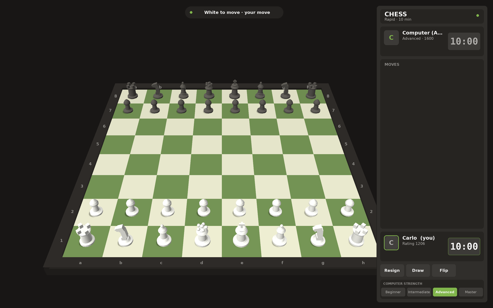

# Roblox Chess — prototype

A chess.com-style chess game for Roblox. Server-authoritative rules engine, a 3D board
you click on, live clocks, captured pieces, SAN move list, promotion picker, draw offers,
resignation and a computer opponent with four strength levels.

**Status: playable prototype (v0.1.0).** Rules are complete and tested; the shell
around it (matchmaking, ratings, cosmetics) is deliberately minimal — see
[docs/ROADMAP.md](docs/ROADMAP.md).


| Opening | Middlegame (selection + capture ring) |
| --- | --- |
|  |  |
| **Promotion picker** | **Checkmate** |
|  |  |

---

## What actually works

**Rules (complete, perft-verified)**
- All legal moves including castling (with through-check rules), en passant, all four promotions
- Check / checkmate / stalemate, threefold repetition, fifty-move rule, insufficient material
- SAN generation with correct disambiguation, `+`/`#` suffixes, and PGN export

**Game shell**
- Server-authoritative moves: the client only ever sends *intents*, never positions
- Server-side clocks with increment support, flag detection, low-time UI state
- Click a piece → server paints selection + legal dots (dots = move, ring = capture)
- Promotion dialog, resign, draw offers (the bot accepts only when it is clearly losing),
  rematch with colour swap, camera flip, spectating when no seat is free
- Computer opponent: negamax + alpha-beta + quiescence, 4 levels (Beginner → Master)
- Second human who joins a solo game takes over the bot's seat mid-game

**Presentation**
- 3D board built from primitives — no uploaded assets, so it drops into any place
- Animated piece movement, capture fade, tweened camera, coordinate rails
- chess.com-flavoured dark HUD: player cards, avatars, clocks, captured pieces,
  two-column move list, status banner, toasts

## Layout

```
src/
  shared/              replicated to the client
    Config.lua         palette, board geometry, camera, tuning
    Chess/Engine.lua   rules engine (pure Lua — runs in Roblox *and* under lua5.4)
    Chess/Ai.lua       search + evaluation
  server/
    init.server.lua    remotes, scene dressing, player seating, loops
    Session.lua        authoritative game state machine (seats, clocks, bot turns)
    Board3D.lua        builds the board/pieces, animations, highlights
  client/
    init.client.lua    click → square → move pipeline
    Hud.lua            all interface elements, built from primitives
    BoardInput.lua     viewport raycast → square
    CameraRig.lua      scriptable camera, colour flip
tests/                 headless suites (perft, rules, notation, search)
tools/render.py        software renderer that produced renders/ (see below)
scripts/               engine → renders/states.json generator
```

## Run it in Roblox

The project is [Rojo](https://rojo.space)-shaped.

```bash
# one-time
aftman install            # or: cargo install rojo
rojo plugin install       # Roblox Studio plugin

# every time
rojo serve                # then hit "Connect" in Studio
```

Or build a place file directly:

```bash
rojo build -o Chess.rbxlx
```

Drop `Chess.rbxlx` into Studio and press Play. You spawn seated as White against the
computer; the second player to join takes Black. Everything runs on the server.

## Tests

The engine is plain Lua, so it is tested outside Roblox — no Studio required:

```bash
sudo apt install lua5.4     # or brew install lua
lua5.4 tests/run_tests.lua      # 58 assertions
lua5.4 tests/run_ai_tests.lua   # 7 assertions + a full self-play game
```

Coverage highlights: `perft(1..4) = 20 / 400 / 8,902 / 197,281` from the start position,
Kiwipete `perft(3) = 97,862`, position 3 `perft(4) = 43,238`, castling rights and
blocked/attacked paths, en passant, underpromotion, SAN disambiguation, threefold
repetition, insufficient material, PGN round-trip, make/unmake symmetry.

```
58 passed, 0 failed
7 passed, 0 failed
```

## How the renders were made

`renders/` is not a screenshot of Studio — it is a faithful offline preview so the
prototype can be reviewed without Roblox installed:

1. `scripts/dump_render_states.lua` plays real lines through the engine and writes
   `renders/states.json` (FEN, SAN list, clocks, selection, legal targets).
2. `tools/render.py` renders those states: a small software 3D renderer (lathe-turned
   pieces, Lambert + rim shading, painter's algorithm) that uses the same part
   dimensions as `Board3D.lua`, plus a pixel-level reimplementation of the HUD
   in `Hud.lua` using the palette from `Config.lua`.

```bash
lua5.4 scripts/dump_render_states.lua && python3 tools/render.py
```

Because every position comes out of the engine, the screenshots cannot show an
impossible board, and the move list always matches the position.

## Known gaps

- No sound, no drag-and-drop (click-click only), no premoves
- Ratings are cosmetic; no persistence, no cross-server matchmaking
- One board per server; no lobby/tournament structure
- The bot thinks synchronously (~50–250 ms at level 3, up to ~1 s at Master)
- Mobile layout is untested; the HUD assumes a landscape viewport ≥ 1000 px wide

MIT licensed — see [LICENSE](LICENSE).
